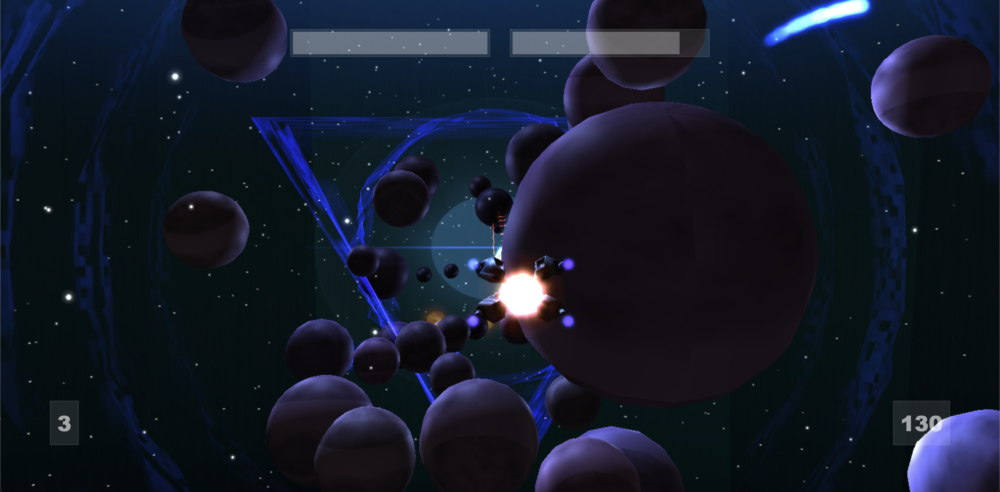

<div align="center">

<p>
  <a href="https://bgibbonsweb.github.io/spacegame" target="_blank" rel="noopener noreferrer"><b>LIVE DEMO: bgibbonsweb.github.io/spacegame</b></a>
</p>

# WebGL Arcade Space Scrolling Shooter

### Real-Time Combat &nbsp;&nbsp;|&nbsp;&nbsp; 3D Spaceflight &nbsp;&nbsp;|&nbsp;&nbsp; Browser-Based Action

<a href="https://bgibbonsweb.github.io/spacegame" target="_blank" rel="noopener noreferrer">
  
</a>

<p>
  <a href="https://bgibbonsweb.github.io/spacegame" target="_blank" rel="noopener noreferrer">
    
  </a>
  &nbsp;
  <a href="https://github.com/ben-gibbons-github/webgl-arcade-space-scrolling-shooter" target="_blank" rel="noopener noreferrer">
    
  </a>
</p>

</div>

<br/>

<!-- Main Content Container -->
<div style="background-color: #121316; color: #f0f0f0; padding: 25px; border-radius: 8px; border: 1px solid #2d3139; font-family: -apple-system, BlinkMacSystemFont, 'Segoe UI', Roboto, Helvetica, Arial, sans-serif;">

<h2 style="border-bottom: 1px solid #333; padding-bottom: 8px; color: #ffffff;">
  <span style="color: #4a9eff; font-family: monospace; font-weight: bold;">&gt;_</span> Overview:
</h2>

<p style="line-height: 1.6; color: #cccccc;">
  A fast-paced browser shooter built with Three.js and WebGL. Pilot through hostile space lanes, dodge hazards, destroy incoming enemies, and survive escalating combat waves in a continuous scrolling battlefield.
</p>

<p>
  <b>&gt;&gt;</b> Play now at
  <a href="https://bgibbonsweb.github.io/spacegame" target="_blank" rel="noopener noreferrer" style="color: #4a9eff;"><b>bgibbonsweb.github.io/spacegame</b></a>
</p>

<br/>

<h2 style="border-bottom: 1px solid #333; padding-bottom: 8px; color: #ffffff;">
  <span style="color: #4a9eff; font-family: monospace; font-weight: bold;">&gt;_</span> Tech Stack & Tooling:
</h2>

<ul style="line-height: 1.8; color: #dddddd;">
  <li><b>Graphics API &gt;&gt;</b> WebGL</li>
  <li><b>3D Framework &gt;&gt;</b> Three.js</li>
  <li><b>Game Logic &gt;&gt;</b> JavaScript (ES6 modules)</li>
  <li><b>Assets &gt;&gt;</b> glTF models, particle FX, texture atlases</li>
</ul>

<br/>

<h2 style="border-bottom: 1px solid #333; padding-bottom: 8px; color: #ffffff;">
  <span style="color: #4a9eff; font-family: monospace; font-weight: bold;">&gt;_</span> Core Gameplay Systems:
</h2>

<div style="background: #1a1c23; padding: 18px; border-radius: 6px; border: 1px solid #2d3139; margin-bottom: 20px;">
  <h3 style="margin-top: 0; color: #ffffff;">1. Player Flight & Combat</h3>
  <p style="color: #cccccc;"><b>Focus &gt;&gt;</b> Responsive movement | Projectile firing | Survival pacing</p>
  <p style="color: #aaaaaa;">Control a space fighter with arcade-style handling while firing through enemy formations and environmental threats.</p>
</div>

<div style="background: #1a1c23; padding: 18px; border-radius: 6px; border: 1px solid #2d3139; margin-bottom: 20px;">
  <h3 style="margin-top: 0; color: #ffffff;">2. Enemies, Waves, and Hazards</h3>
  <p style="color: #cccccc;"><b>Focus &gt;&gt;</b> Enemy spawning | Difficulty progression | Deathwall pressure</p>
  <p style="color: #aaaaaa;">Face increasingly dense encounters powered by dynamic spawn logic, moving hazards, and escalating wave intensity.</p>
</div>

<div style="background: #1a1c23; padding: 18px; border-radius: 6px; border: 1px solid #2d3139; margin-bottom: 20px;">
  <h3 style="margin-top: 0; color: #ffffff;">3. Visual Effects & Feedback</h3>
  <p style="color: #cccccc;"><b>Focus &gt;&gt;</b> Particle systems | Lens flare | Explosion FX</p>
  <p style="color: #aaaaaa;">Layered visual feedback reinforces impact moments and gives the battlefield a bright, high-energy arcade look.</p>
</div>

<br/>

<h2 style="border-bottom: 1px solid #333; padding-bottom: 8px; color: #ffffff;">
  <span style="color: #4a9eff; font-family: monospace; font-weight: bold;">&gt;_</span> Project Structure:
</h2>

<ul style="line-height: 1.8; color: #dddddd;">
  <li><b>Entry &gt;&gt;</b> SpaceGame.html</li>
  <li><b>Core Source &gt;&gt;</b> src/ (player, enemies, bullets, levels, powerups, fx)</li>
  <li><b>Libraries &gt;&gt;</b> lib/ (Three.js + loaders + particle systems)</li>
  <li><b>Assets &gt;&gt;</b> models/, tex/</li>
</ul>

<br/>

<h2 style="border-bottom: 1px solid #333; padding-bottom: 8px; color: #ffffff;">
  <span style="color: #4a9eff; font-family: monospace; font-weight: bold;">&gt;_</span> Local Development:
</h2>

<p style="color: #cccccc;">Clone and serve locally with any static web server:</p>

```bash
# Clone the repository
git clone https://github.com/ben-gibbons-github/webgl-arcade-space-scrolling-shooter.git

# Enter the project directory
cd webgl-arcade-space-scrolling-shooter

# Serve locally (pick one)
npx serve .
# or
python3 -m http.server 8080
```

<p style="color: #aaaaaa;">
  Then open <b>SpaceGame.html</b> in your browser (or via your local server route).
</p>

</div>